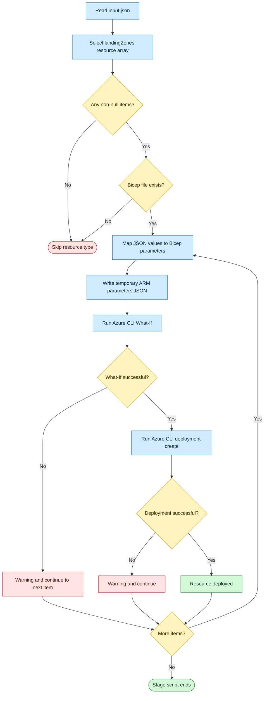
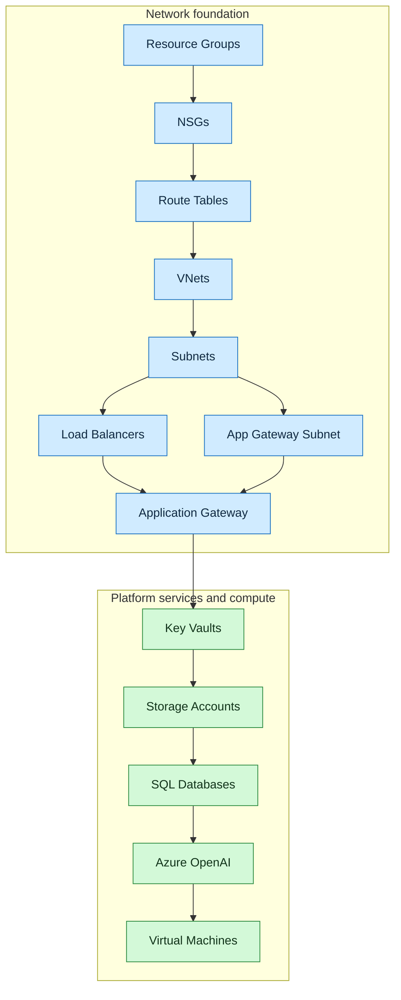
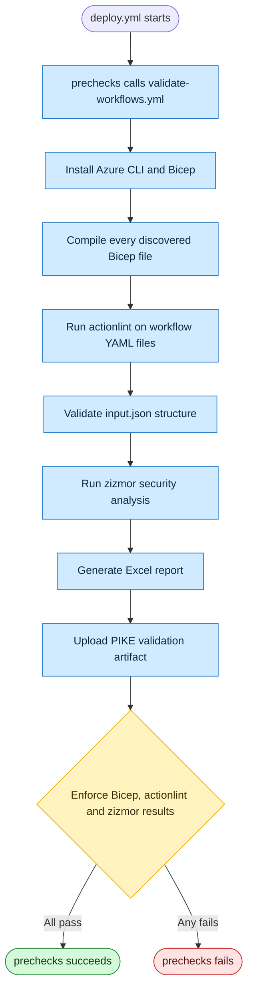
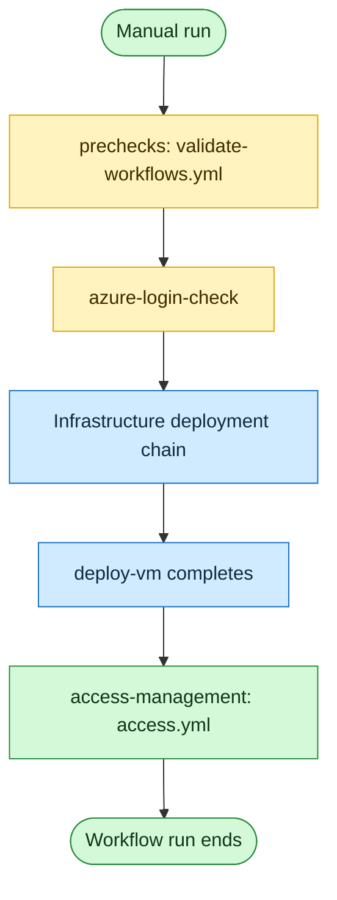

# PIKE Deployment Workflow — deploy.yml

> **Update — this document describes the previous workflow.** The current `deploy.yml` works like this:
>
> - **`input.json` holds only yes/no flags:** `environment` plus a `yes`/`no` for each resource type (`resourceTargets`) and for each access request type (`accessRequests`).
> - **Values come from the GitHub Environment:** every job runs in the environment named by `input.json` (for example `dev`) and reads all values from that environment's variables and secrets. See [github-environment-variables.md](../github-environment-variables.md).
> - **Names are built in the modules:** each Bicep module builds its resource names from naming tokens. See [resource-naming-standard.md](../resource-naming-standard.md).
> - **Job flow:** `prechecks → plan (read input.json, build ordered plan) → context (Azure login, resource group name) → deploy (one job, walks the plan sequentially) → access-management (rbac job, pim job) → inventory (CSV, always)`.
> - **Dynamic sequential plan:** the `plan` job lists only the resources set to `yes` plus their prerequisites, in dependency order. Example: only `storageAccount: "yes"` gives the plan `Resource Group → Storage Account`. Resources not in the plan do not appear in the run at all.
> - **Prerequisites added automatically:** every resource needs the resource group; subnets and PostgreSQL need the VNet; VMs and the load balancer need the subnet; the Application Gateway needs its subnet. An auto-added prerequisite is created only if it does not exist (existing ones are not re-applied); the resource group is always applied because it is idempotent.
> - **Failures:** when an entry fails, the entries that depend on it are skipped and independent entries continue. The run fails if anything failed or was blocked. The OIDC login is refreshed before each entry so long plans do not outlive the Azure CLI token.
> - **Shared deploy action:** every deployment goes through `.github/actions/deploy-bicep`. It maps the variables to module parameters, validates them, then runs What-If and the deployment. No PowerShell scripts are used.

**Branch:** dev  
**Workflow:** .github/workflows/deploy.yml  
**Purpose:** Explain the deployment workflow, PowerShell logic, input/template paths, parameter generation, What-If previews, and Azure deployments.

This document explains the deployment workflow and its integration with the reusable `validate-workflows.yml` and `access.yml` workflows. It summarizes their responsibilities and run-graph behavior; detailed implementation of validation and RBAC/PIM processing is maintained in their respective workflow documentation.

## 1. Overall execution flow

The workflow starts manually through workflow_dispatch. It runs on a self-hosted Windows x64 runner. The reusable validation workflow is a prerequisite, followed by Azure authentication and the infrastructure deployment jobs.

```mermaid
flowchart TD
 A([Manual start]) --> B[Repository prechecks]
 B --> C[Azure OIDC login check]
 C --> D[Resource Groups]
 D --> E[NSGs]
 E --> F[Route Tables]
 F --> G[Virtual Networks]
 G --> H[Subnets]
 H --> I[Load Balancers]
 H --> J[Application Gateway Subnet]
 I --> K[Application Gateway]
 J --> K
 K --> L[Key Vaults]
 L --> M[Storage Accounts]
 M --> N[SQL Databases]
 N --> O[Azure OpenAI]
 O --> P[Virtual Machines]
 P --> R[RBAC and PIM access management]\n R --> Q([Deployment chain ends])
 classDef start fill:#243b53,stroke:#102a43,color:#fff
 classDef check fill:#fff3bf,stroke:#e0a800,color:#3d2c00
 classDef network fill:#d0ebff,stroke:#1971c2,color:#102a43
 classDef service fill:#d3f9d8,stroke:#2b8a3e,color:#12351b
 class A,Q start
 class B,C check
 class D,E,F,G,H,I,J,K network
 class L,M,N,O,P service
```

The arrows represent YAML job dependencies. Note that the deployment jobs use an `if` condition containing `always()` and explicitly check only that prechecks and Azure login succeeded. They do not explicitly check that the preceding deployment job succeeded. Therefore, a later job may run even if an intermediate deployment job failed.

## 2. Workflow-level settings

| Setting | Meaning |
|---|---|
| `workflow_dispatch` | The workflow is started manually from GitHub Actions. |
| `contents: read` | Allows the workflow to read repository content. |
| `id-token: write` | Allows GitHub Actions to request an OIDC token for Azure federated authentication. |
| `runs-on: [self-hosted, X64, Windows]` | Selects the registered Windows x64 self-hosted runner. |
| `needs` | Defines job dependencies and scheduling order. |
| `environment: dev` | Associates the job with the GitHub dev environment and its secrets/protection rules. |
| `actions/checkout@v4` | Checks out the repository into the runner workspace. |
| `shell: pwsh` | Runs the script using PowerShell. |

## 3. Stage 1 — Azure OIDC login and subscription check

**Job:** `azure-login-check`

### 3.1 Check the subscription secret

The workflow maps the GitHub secret into an environment variable:

```yaml
env:
  AZURE_SUBSCRIPTION_ID: ${{ secrets.AZURE_SUBSCRIPTION_ID }}
```

PowerShell:

```powershell
$ErrorActionPreference = "Stop"
if ([string]::IsNullOrWhiteSpace($env:AZURE_SUBSCRIPTION_ID)) {
  throw "AZURE_SUBSCRIPTION_ID is empty or unavailable to this workflow."
}
if ($env:AZURE_SUBSCRIPTION_ID -notmatch '^[0-9a-fA-F]{8}-[0-9a-fA-F]{4}-[0-9a-fA-F]{4}-[0-9a-fA-F]{4}-[0-9a-fA-F]{12}$') {
  throw "AZURE_SUBSCRIPTION_ID is not a valid GUID."
}
```

- `$env:AZURE_SUBSCRIPTION_ID` reads an environment variable. PowerShell uses the `$env:` prefix for environment variables.
- `[string]::IsNullOrWhiteSpace(...)` checks whether the value is null, empty, or only whitespace.
- `-notmatch` checks the value against a regular expression. The expression enforces the standard GUID pattern: 8-4-4-4-12 hexadecimal characters.
- `throw` raises a terminating error and stops this job.
- The value is deliberately not printed to the Actions log.

This checks that the secret is present and shaped like a GUID. It does not yet prove that the subscription exists or that the identity has access.

### 3.2 Authenticate using OIDC

```yaml
- uses: azure/login@v2
  with:
    client-id: ${{ secrets.AZURE_CLIENT_ID }}
    tenant-id: ${{ secrets.AZURE_TENANT_ID }}
    subscription-id: ${{ secrets.AZURE_SUBSCRIPTION_ID }}
```

The azure/login action obtains a GitHub OIDC token and uses the federated credential configured in Microsoft Entra ID. This avoids storing a client secret in the workflow.

- **Client ID:** identifies the Entra application/service principal.
- **Tenant ID:** identifies the Entra tenant.
- **Subscription ID:** identifies the subscription to use.
- **id-token: write:** repository permission required to request the OIDC token.

### 3.3 Select and verify the subscription

```powershell
$az = "C:\Program Files\Microsoft SDKs\Azure\CLI2\wbin\az.cmd"
& $az account set --subscription $env:AZURE_SUBSCRIPTION_ID
if ($LASTEXITCODE -ne 0) { throw "Could not select subscription." }
& $az account show --query "{name:name,id:id,tenantId:tenantId}" -o json
if ($LASTEXITCODE -ne 0) { throw "Azure subscription verification failed." }
```

- `$az` stores the full path to Azure CLI's Windows command file. This avoids relying on PATH configuration on the self-hosted runner.
- `&` is PowerShell's call operator; it executes the command stored in the variable.
- `az account set --subscription` changes the active Azure CLI subscription context.
- `$LASTEXITCODE` captures the exit code of the last native command. Zero normally means success; non-zero means failure.
- `az account show` confirms the active context. The JMESPath `--query` returns only name, ID and tenant ID; `-o json` formats the result as JSON.

```mermaid
flowchart TD
 A[Read subscription secret] --> B{Empty or whitespace?}
 B -- Yes --> X([Throw error])
 B -- No --> C{GUID format valid?}
 C -- No --> X
 C -- Yes --> D[azure/login@v2 requests OIDC authentication]
 D --> E[Entra ID validates federated identity]
 E --> F[Azure CLI selects subscription]
 F --> G[az account show verifies context]
 G --> H([Login check succeeds])
 classDef decision fill:#fff3bf,stroke:#e0a800,color:#3d2c00
 classDef action fill:#d0ebff,stroke:#1971c2,color:#102a43
 classDef success fill:#d3f9d8,stroke:#2b8a3e,color:#12351b
 classDef failure fill:#ffe3e3,stroke:#c92a2a,color:#5c1111
 class B,C decision
 class A,D,E,F,G action
 class H success
 class X failure
```

## 4. Common pattern used by deployment stages

Each resource job checks out the repository and performs its own Azure login. Jobs are separate executions, so the Azure CLI login session from azure-login-check should not be assumed to carry over.

### 4.1 Read input.json

```powershell
$cfg = Get-Content "input.json" -Raw | ConvertFrom-Json
```

- `Get-Content` reads input.json from the checked-out repository root.
- `-Raw` reads the complete file as one string.
- `|` pipes that string into the next command.
- `ConvertFrom-Json` parses the JSON into PowerShell objects.
- `$cfg` is then used to read properties such as `$cfg.landingZones.vnets` and `$cfg.landingZones.vms`.

The workflow does not pass the entire input.json directly to Bicep. It selects one resource array and maps each resource object into a separate ARM parameters file.

### 4.2 Check the Bicep file exists

Example:

```powershell
$template = "modules/networking/vnet.bicep"
if (-not (Test-Path -LiteralPath $template)) {
  Write-Warning "Module is missing. Skipping..."
  return
}
```

The path is relative to the repository root. `Test-Path -LiteralPath` checks that exact path. If the file is missing, the script logs a warning and `return` exits the current PowerShell script block, skipping that resource type.

### 4.3 Select configured resources

```powershell
$items = @($cfg.landingZones.vnets | Where-Object { $null -ne $_ })
```

- `$cfg.landingZones.vnets` selects the VNet array from input.json.
- `Where-Object { $null -ne $_ }` filters out null entries.
- `@(...)` forces the result to be an array, even if there is only one item.
- If `$items.Count -eq 0`, the stage logs that no entries are configured and skips the resource type.

### 4.4 Map values and generate a parameters file

A typical stage uses a hashtable to map JSON properties to Bicep parameter names:

```powershell
$v = @{
  location = $x.location
  vnetName = $x.name
  addressPrefixes = @($x.addressPrefixes)
  tags = $x.tags
}
$p = @{
  '$schema' = 'https://schema.management.azure.com/schemas/2019-04-01/deploymentParameters.json#'
  contentVersion = '1.0.0.0'
  parameters = @{}
}
foreach ($k in $v.Keys) {
  $p.parameters[$k] = @{ value = $v[$k] }
}
$f = "$env:RUNNER_TEMP\vnet.json"
$p | ConvertTo-Json -Depth 100 | Set-Content $f
```

- `$x` is the current resource object from the input array.
- `$v` maps the input fields to the exact parameter names expected by the Bicep module. The left side is the Bicep parameter name; the right side reads a value from input.json.
- `@(...)` ensures an array-valued parameter stays an array.
- `$p` creates the ARM deployment parameters structure. Each parameter has a `value` property.
- `foreach` iterates over the mapping keys and populates `$p.parameters`.
- `ConvertTo-Json -Depth 100` serializes nested objects and arrays.
- `$env:RUNNER_TEMP` is the runner's temporary directory. The generated file is not committed to the repository.

Some stages construct the parameters hashtable directly rather than using an intermediate `$v` map. The output is still an ARM parameters JSON file.

### 4.5 What-If and deployment

Typical resource-group-scope commands:

```powershell
& $az deployment group what-if -g $x.resourceGroupName -f "modules/networking/vnet.bicep" --parameters "@$f"
if ($LASTEXITCODE -ne 0) {
  Write-Warning "VNet What-If failed"
  continue
}
& $az deployment group create -g $x.resourceGroupName -n "pike-vnet-..." -f "modules/networking/vnet.bicep" --parameters "@$f"
```

- `az deployment group what-if` previews the changes Azure Resource Manager expects to make. It does not apply them.
- `-g` specifies the target resource group.
- `-f` specifies the Bicep template file.
- `--parameters "@$f"` tells Azure CLI to load parameters from the generated file. The leading `@` is Azure CLI's file-input syntax.
- If What-If returns a non-zero exit code, `continue` skips the current item and moves to the next item in the loop.
- `az deployment group create` applies the deployment.
- `-n` supplies a deployment operation name. The workflow combines the GitHub run ID with a random GUID fragment to make names distinct.

**Resource Group exception:** deploy-rg uses subscription-scope commands, `az deployment sub what-if` and `az deployment sub create`, with `--location` because the deployment itself is at subscription scope.



## 5. Deployment stages and their exact file mappings

All stages below use the common pattern above unless a special behavior is called out.

| Job | input.json array | Bicep template | Generated parameter file | Scope |
|---|---|---|---|---|
| deploy-rg | `landingZones.resourceGroups` | `modules/RG/resourcegroup.bicep` | `$RUNNER_TEMP\rg-params.json` | Subscription |
| deploy-nsg | `landingZones.nsgs` | `modules/networking/nsg.bicep` | `nsg.json` | Resource group |
| deploy-route-table | `landingZones.routeTables` | `modules/networking/routetable.bicep` | `rt.json` | Resource group |
| deploy-vnet | `landingZones.vnets` | `modules/networking/vnet.bicep` | `vnet.json` | Resource group |
| deploy-subnet | `landingZones.subnets` | `modules/networking/subnet.bicep` | `subnet.json` | Resource group |
| deploy-load-balancer | `landingZones.loadBalancers` | `modules/loadbalancer/lb.bicep` | `lb.json` | Resource group |
| deploy-appgw-subnet | `landingZones.applicationGatewaySubnets` | `modules/networking/applicationGatewaySubnet.bicep` | `appgw-subnet.json` | Resource group |
| deploy-appgw | `landingZones.applicationGateways` | `modules/networking/applicationGateway.bicep` | `appgw.json` | Resource group |
| deploy-keyvault | `landingZones.keyVaults` | `modules/security/keyvault.bicep` | `kv.json` | Resource group |
| deploy-storage | `landingZones.storageAccounts` | `modules/storage/storageAccount.bicep` | `storage.json` | Resource group |
| deploy-sql | `landingZones.sqlDatabases` | `modules/database/sql.bicep` | `sql.json` | Resource group |
| deploy-openai | `landingZones.openAiServices` | `modules/ai/openai.bicep` | `openai.json` | Resource group |
| deploy-vm | `landingZones.vms` | `modules/compute/vm.bicep` | `vm.json` | Resource group |

### Stage-specific behavior and parameter mapping

#### 5.1 Resource Groups — deploy-rg

Maps `rgName` to Bicep parameter `rgname`, plus `location` and `tags`. It writes `$env:RUNNER_TEMP\rg-params.json` and runs subscription-scope What-If and create commands. This stage creates the resource groups targeted by later deployments.

#### 5.2 Network Security Groups — deploy-nsg

Maps `$x.name` to `nsgName`, along with location, securityRules and tags. The security rules are passed as an array. It deploys the NSG into `$x.resourceGroupName`.

#### 5.3 Route Tables — deploy-route-table

Maps name to `routeTableName`, plus location, `disableBgpRoutePropagation`, routes and tags. The routes are passed as an array. It targets `$x.resourceGroupName`.

#### 5.4 Virtual Networks — deploy-vnet

Maps location, name to `vnetName`, address prefixes, tags, DNS servers and an empty `subnets=@()` array.

**Existing-VNet guard:**

```powershell
& $az network vnet show -g $x.resourceGroupName -n $x.name --query name -o tsv 2>$null
if ($LASTEXITCODE -eq 0) {
  Write-Host "VNet already exists; skipping VNet template to avoid replacing existing subnet configuration."
  continue
}
```

This asks Azure whether the named VNet exists in the resource group. `2>$null` suppresses error-stream output, such as the expected not-found response. If the command succeeds, the VNet exists and `continue` skips that item. This guard avoids running the VNet template with an empty subnet list against an existing VNet.

#### 5.5 Subnets — deploy-subnet

Maps VNet name, subnet name, address prefix, NSG name, route-table name, service endpoints, private endpoint network policies and private link service network policies. It targets the resource group specified in the input object.

#### 5.6 Load Balancers — deploy-load-balancer

Maps name, location, SKU name/tier, tags, VNet/subnet names, frontends, backend pools, probes and load-balancing rules. The nested collections are passed as arrays.

#### 5.7 Application Gateway Subnet — deploy-appgw-subnet

Maps `vnetName`, `subnetName` and `subnetAddressPrefix`. It creates the dedicated subnet used by the Application Gateway configuration.

#### 5.8 Application Gateway — deploy-appgw

Maps Application Gateway name, location, VNet/subnet, public IP name, private frontend IP, min/max capacity, frontend ports, backend pools, backend HTTP settings, health probes, listeners, routing rules, HTTP/2 setting and tags.

It depends on both `deploy-load-balancer` and `deploy-appgw-subnet`, so GitHub Actions waits for both jobs to finish.

#### 5.9 Key Vaults — deploy-keyvault

Gets the active tenant ID using:

```powershell
$tenant = & $az account show --query tenantId -o tsv
```

Maps Key Vault name, deployment suffix, location, tenant ID, SKU, RBAC authorization, purge protection, soft-delete retention, public network access and tags. The deployment suffix is built from the GitHub run ID and run attempt and passed as `deploymentSuffix`.

#### 5.10 Storage Accounts — deploy-storage

Prints configured account names (not secrets), then maps account name, deployment suffix, location, tags, SKU, kind, access tier, minimum TLS version, HTTPS-only setting, blob public access, shared-key access, public network access, container names, blob service name and container public access.

#### 5.11 SQL Databases — deploy-sql

Maps location, server/database names, administrator login, SQL version, database SKU name/tier/capacity/max size, public network access, minimum TLS version and tags.

The SQL password comes from the GitHub secret `SQL_ADMIN_PASSWORD`, mapped to the job environment. It is passed separately to What-If and create as `administratorLoginPassword=$env:SQL_ADMIN_PASSWORD`, rather than being written to the generated JSON file.

#### 5.12 Azure OpenAI — deploy-openai

Prints configured service names, then maps account name, deployment suffix, location, SKU, custom subdomain name, public network access and tags. The deployment suffix uses the GitHub run ID and attempt.

#### 5.13 Virtual Machines — deploy-vm

Maps location, computer name, VM name, admin username, VM size, tags, VNet/subnet names, NIC name, private IP allocation method, image publisher/offer/SKU/version, OS disk storage type/create option/size and boot diagnostics.

The VM administrator password comes from `VM_ADMIN_PASSWORD` and is passed separately as `vmAdminPassword=$env:VM_ADMIN_PASSWORD` to What-If and create. It is not written into the generated JSON file.

### Deployment dependency diagram



This diagram reflects the YAML job dependency chain; it should not be interpreted as a statement that every service is technically dependent on the preceding resource.

## 6. Job dependency and if-condition behavior

A deployment job uses a condition similar to:

```yaml
needs: [prechecks, azure-login-check, deploy-vnet]
if: ${{ always() && needs.prechecks.result == 'success' && needs.azure-login-check.result == 'success' }}
```

- `needs` makes the job wait for the listed jobs.
- `always()` asks GitHub Actions to evaluate the condition even if a dependency failed or was skipped.
- The condition requires prechecks and azure-login-check to have succeeded.
- It does **not** require `needs.deploy-vnet.result == 'success'`.

Thus a downstream stage may still run after its predecessor failed, provided prechecks and Azure login succeeded. If strict sequencing is intended, add the predecessor result to the condition, for example:

```yaml
if: ${{ always() && needs.prechecks.result == 'success' && needs.azure-login-check.result == 'success' && needs.deploy-vnet.result == 'success' }}
```

Use the relevant predecessor job name in each stage.

## 7. Important behavior and review observations

1. The workflow generates a separate ARM parameters JSON file for each resource item; it does not submit the raw input.json as the Bicep parameter file.
2. What-If previews changes; the subsequent `create` command applies them.
3. A missing Bicep file or empty input array causes that resource type to be skipped.
4. What-If failure logs a warning and continues to the next resource item.
5. Deployment-create failure also logs a warning and continues. The script does not throw on these non-zero exit codes, so a job may still report success even if one or more resources failed.
6. Existing VNets are deliberately skipped by the VNet existence check.
7. Azure login is repeated in every deployment job because each job has its own execution context.
8. SQL and VM passwords are injected as environment variables and passed as CLI parameter arguments. They are not stored in the generated JSON files. Do not print these values or enable verbose command tracing around them.
9. There is no explicit final deployment-failure summary. Consider collecting failed resource names and failing the job at the end if you want the GitHub Actions status to represent partial deployment failures.
10. The template variable used by `Test-Path` and the literal path used by Azure CLI must be kept aligned when changing module paths.

## 8. Troubleshooting

| Log message / symptom | Meaning | What to check |
|---|---|---|
| Subscription ID empty/unavailable | Secret did not reach the job environment. | Confirm the secret exists in the GitHub dev environment and the job references that environment. |
| Subscription ID is not a valid GUID | Secret value has an invalid format. | Check the subscription ID; remove braces or extra text if present. |
| Azure login / federated credential failure | OIDC trust could not be established. | Check client ID, tenant ID, GitHub environment/branch subject and Entra federated credential. |
| Could not select subscription | Azure CLI could not set the requested subscription. | Check subscription ID and identity access to that subscription. |
| Module is missing | Expected Bicep file is absent at the path in the dev branch. | Check repository path and filename capitalization. |
| No entries configured | The corresponding input array is empty or has no non-null items. | Check the matching landingZones array in root input.json. |
| What-If failed | Azure could not calculate the proposed deployment. | Inspect preceding CLI output; check scope, parameters, resource group and permissions. |
| Deployment failed | ARM deployment returned a non-zero exit code. | Inspect deployment operations/error details in Azure and the preceding CLI output. |
| Job is green but resource is missing | A warning/continue path may have skipped the resource. | Search logs for What-If failed, deployment failed, missing module or skip messages. |

## 9. Reusable workflow integration — access.yml and validate-workflows.yml

The deployment workflow uses two reusable-workflow concepts differently. This distinction determines which jobs appear in the GitHub Actions run graph.

### 9.1 Repository validation — validate-workflows.yml

**File:** `.github/workflows/validate-workflows.yml`  
**Invocation from deploy.yml:** the `prechecks` job.

```yaml
prechecks:
  name: Repository validation (Bicep, workflows and input)
  uses: ./.github/workflows/validate-workflows.yml
```

The validation workflow declares `on: workflow_call`, so it is reusable and is called as a job inside the `deploy.yml` run. In the Actions run graph, `prechecks` is visible as a reusable-workflow job. Opening it exposes the called workflow's validation job and steps/logs. The YAML source itself remains in the repository at `.github/workflows/validate-workflows.yml`.

**What validate-workflows.yml currently checks**

| Validation | Implementation | Coverage / limitation |
|---|---|---|
| Azure CLI setup | Downloads/installs Azure CLI and checks `az version`. | Confirms the CLI is available on the Windows runner. |
| Bicep CLI setup | Installs/upgrades Bicep and checks `az bicep version`. | Prepares the compiler used by the next step. |
| Bicep compilation and diagnostics | Recursively discovers every `*.bicep` file in the repository, excluding `.git` and `.bicep-cache`, then runs `az bicep build` for each file. | Checks each discovered file independently and records its relative path, status, severity, BCP code, line and diagnostic. This is compilation/diagnostic validation; it does not deploy the modules or prove that Azure runtime permissions and resource constraints will succeed. |
| GitHub Actions YAML lint | Discovers all `.yml` and `.yaml` files under `.github/workflows` and runs actionlint against the discovered files. | Covers the workflow files in that directory, including deploy.yml, access.yml and validate-workflows.yml when present. |
| input.json syntax and structural checks | Parses root `input.json`; checks root object, `environment == dev`, non-empty `location`, `landingZones` object, known landing-zone arrays, null array entries and RBAC collection types. | It is not a complete JSON Schema validation. It does not validate every required property, every nested property/type, all Bicep parameter compatibility, or the full PIM request structure. |
| Workflow security analysis | Runs zizmor against `.github/workflows`. | Produces workflow security audit findings in JSON. |
| Excel report | Builds `pike-validation-report.xlsx`. | Contains **YAML Validation** and **Bicep Validation** worksheets. The YAML sheet includes actionlint and zizmor results; the Bicep sheet lists findings per discovered Bicep file. |
| Artifact upload | Uploads `pike-validation-report.xlsx` as `PIKE-Validation-${{ github.run_id }}`. | Retention is 30 days; download it from the run's Artifacts section. |

The validation job uses `continue-on-error: true` for the Bicep, actionlint and zizmor steps so that report generation can still run and collect their findings. The final **Enforce validation results** step checks those step outcomes and fails the validation job if any of those three checks failed. The input.json validation step is not marked `continue-on-error`; a failure there stops the job before later steps can run, so the Excel report/artifact may not be generated for that run.

**Validation flow**



Because `azure-login-check` has `needs: prechecks`, Azure authentication and the infrastructure jobs are gated by successful repository validation.

### 9.2 Access management — access.yml

**File:** `.github/workflows/access.yml`  
**Invocation from deploy.yml:** the `access-management` job.  
**Current status:** actively called as the final reusable-workflow job after the VM deployment job.

The current caller configuration is:

```yaml
access-management:
  name: Final RBAC and PIM access management
  needs: [prechecks, azure-login-check, deploy-vm]
  if: ${{ always() && needs.prechecks.result == 'success' && needs.azure-login-check.result == 'success' }}
  uses: ./.github/workflows/access.yml
  with:
    environment: dev
  secrets: inherit
```

Because `access.yml` declares `workflow_call`, GitHub runs it as a reusable workflow within the same `deploy.yml` workflow run. The Actions run graph displays the `access-management` caller job and lets you open the called workflow's nested jobs and logs. The source remains in `.github/workflows/access.yml`; it is not copied into `deploy.yml`.

**Execution order and dependency behavior**

- `access-management` waits for `prechecks`, `azure-login-check` and `deploy-vm` because they are listed under `needs`.
- Its `if` condition uses `always()` and checks only that `prechecks` and `azure-login-check` succeeded.
- It does **not** check `needs.deploy-vm.result == 'success'`. Therefore, access management can still run if the VM job fails or is skipped, provided the two prerequisite checks succeeded.
- This is the current behavior, not a proposed future integration.

**What access.yml currently does**

- Declares `workflow_call` and accepts an optional `environment` input, defaulting to `dev`.
- Runs on the self-hosted Windows x64 runner, checks out the repository and authenticates to Azure using OIDC.
- Reads root `input.json` and processes the RBAC arrays `rbac.subscriptionAccess`, `rbac.resourceGroupAccess` and `rbac.resourceAccess`.
- Resolves a principal from `principalId` or looks it up using `principalEmail` and `principalType` (User, Group or ServicePrincipal).
- Runs RBAC Bicep deployments for subscription, resource-group and supported resource scopes, with What-If before create.
- Processes PIM requests from supported `pim` input shapes and submits role eligibility schedule requests through Azure Resource Manager REST.
- Produces an access results workbook with separate RBAC and PIM worksheets and uploads it as an Actions artifact.

**Important execution detail:** each GitHub Actions job has an independent runner context. The Azure login performed by `access.yml` does not carry over to the deployment jobs, and the login in `deploy.yml` does not carry into `access.yml`. Each workflow/job that invokes Azure CLI must authenticate in its own execution context; `access.yml` performs its own OIDC login.

**Current deployment run graph**



The diagram shows dependency ordering, not a guarantee that every resource deployment succeeded. Because the access job's condition does not require `deploy-vm` to succeed, it can still start after a VM deployment failure. Also inspect the called workflow's final enforcement logic before treating a successful access-management job as proof that every individual RBAC/PIM request succeeded.

## 10. Out of scope

- Full Bicep resource declarations and their complete parameter schemas.
- A complete JSON Schema for input.json.
- Detailed Azure RBAC/PIM role licensing, tenant configuration and permissions troubleshooting.

Read this document with the individual module documentation and the separate validation/access workflow documentation for the full deployment picture.
